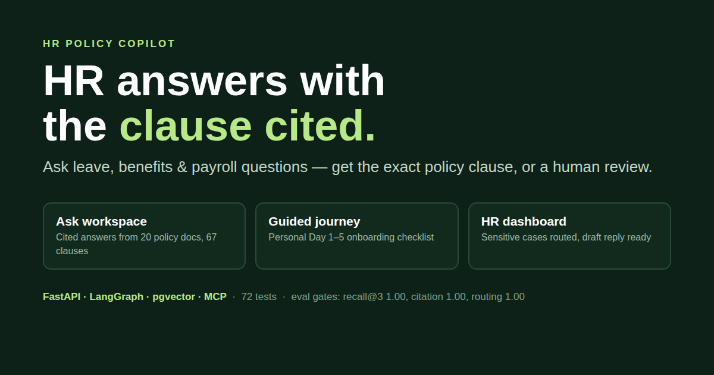
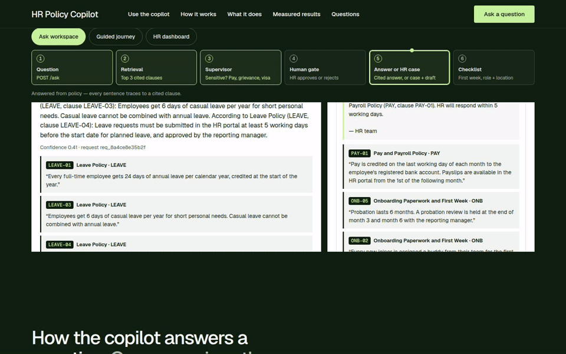
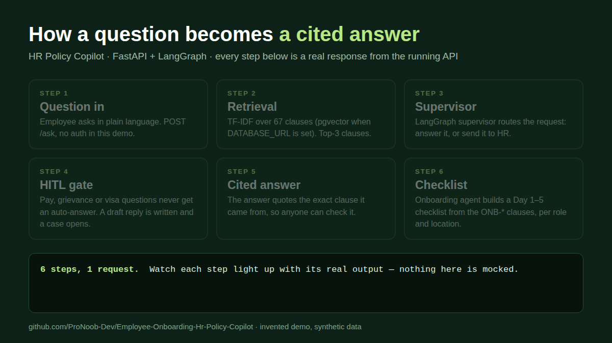

# Client Employee Onboarding & HR Policy Copilot

[](https://github.com/ProNoob-Dev/Employee-Onboarding-Hr-Policy-Copilot/actions/workflows/ci.yml)
[](https://www.python.org/downloads/)
[](LICENSE)



Ask a leave, benefits or payroll question — get the answer with the exact
policy clause it came from. Sensitive questions (pay, grievance, visa) never
get an auto-answer: they go to HR with a draft reply already written. New
joiners get a personalised Day 1–5 checklist built from the same policies.

> **This is an invented demo / reference project. It is NOT real client work.**
> There is no real client, no real employees, and no real HR policy data.
> All policy documents, employee names, questions, and answers are synthetic,
> written for this demo. The figures sometimes quoted for this project idea
> (88% autonomous, 40% faster, 25% less effort) are invented claims, **not**
> measured results — this repo reports only measured numbers from its own
> golden eval set (see [Eval](#eval)).

## Watch it work



A real screen recording of the app running against the local API — a cited
leave answer, a Day 1–5 checklist for a Data Engineer in Pune, and the HR
review queue with CASE-0001. Full video (19s, with music):
[`docs/demo.mp4`](docs/demo.mp4).

One FastAPI + LangGraph copilot that answers HR questions grounded in a cited
policy clause, builds a personalised first-week checklist for a new joiner,
and routes only sensitive cases (pay, grievance, visa) to HR with a draft
reply already written — behind a human-in-the-loop review gate. Every answer,
routing decision, and review is written to a JSONL audit trail.

## What it does

| Endpoint | Behaviour |
|---|---|
| `POST /ask` | Cited answer from the policy corpus, or a routed case (sensitive / low-confidence) with no substantive answer |
| `POST /onboarding/{employee_id}/checklist` | Role- and location-specific first-week checklist (days 1–5) |
| `POST /cases/{id}/review` | HITL approve / reject of a routed case (a reviewed case cannot be reviewed again — 409) |
| `GET /cases` | Review queue, filterable by status |
| `GET /metrics` | Measured counts: answered, routed, autonomous rate, citation coverage, avg confidence |
| `GET /health` | `{"status": "ok", "llm_provider": "local", "retrieval": "tfidf"}` |

## How it works — step by step



Six steps, one request. Every output below is a real response from the
running API (local mode, no Azure key) — not a mock.

**Step 1 — Question in.** An employee asks in plain language:

```bash
curl -X POST localhost:8000/ask -d '{"question": "How many days of annual leave do I get?"}'
```

**Step 2 — Retrieval.** TF-IDF over the 67 synthetic clauses (pgvector when
`DATABASE_URL` is set) returns the top 3: `LEAVE-01`, `LEAVE-03`, `LEAVE-04`.

**Step 3 — Supervisor (LangGraph).** The supervisor routes the request —
`answered` here, confidence `0.41`. A sensitive or low-confidence question
never reaches this step's answer path.

**Step 4 — HITL gate.** Pay, grievance and visa questions are routed to HR
with a draft reply already written, and no substantive answer is given:

```json
{"route": "routed_to_hr", "route_reason": "sensitive_pay",
 "case_id": "CASE-0001", "message": "This question has been routed to HR with a draft reply. An HR reviewer will respond."}
```

The case sits in `GET /cases` as `pending_review` until a human approves or
rejects it (`POST /cases/{id}/review`; a reviewed case cannot be reviewed
again — 409).

**Step 5 — Cited answer.** The answer quotes the exact clause it came from:

```json
{"route": "answered", "confidence": 0.409,
 "answer": "According to Leave Policy (LEAVE, clause LEAVE-01): Every full-time employee gets 24 days of annual leave per calendar year...",
 "citations": [{"doc_id": "LEAVE", "clause_id": "LEAVE-01", "title": "Leave Policy",
   "quote": "Every full-time employee gets 24 days of annual leave per calendar year, credited at the start of the year."}]}
```

**Step 6 — Checklist.** The onboarding agent builds a Day 1–5 checklist from
the `ONB-*` clauses, per role and location:

```bash
curl -X POST localhost:8000/onboarding/EMP-101/checklist \
  -d '{"role": "Data Engineer", "location": "Pune", "start_date": "2026-11-17"}'
# → 8 items: "Complete HR paperwork" (ONB-01), "Collect office badge and desk" (ONB-01),
#   "Collect laptop and logins" (ONB-IT-01), ...
```

Every step writes to the JSONL audit trail, and `GET /metrics` reports the
measured counts (`answered`, `routed_to_hr`, `autonomous_rate`,
`citation_coverage`, `avg_confidence`).

Verified end to end on 2026-11-14:

```text
$ python scripts/eval.py
eval: recall@3=1.0 citation=1.0 routing=1.0 pii_leaks=0 autonomous_rate=0.545 avg_latency_ms=6.1
GATES PASSED

$ pytest -q
72 passed in 2.09s
```

Note on the stack: this repo uses **LangGraph alone** — no LangChain, no
RAGAS/DeepEval (the eval is a deterministic exact-match scorer over the
22-question golden set), and no Langfuse/OpenTelemetry vendor calls. See
[What is deliberately not built](#what-is-deliberately-not-built).

## Setup

```bash
python -m venv .venv && source .venv/bin/activate
pip install -r requirements.txt
python scripts/seed.py          # loads 20 synthetic policy docs (idempotent)
uvicorn app.main:app --port 8000
```

No Azure key, Postgres, or Docker is needed to run or test. The default is
fully offline: a deterministic local answerer over a stdlib TF-IDF retriever.

## Environment variables

| Var | Required? | Meaning |
|---|---|---|
| `AZURE_OPENAI_API_KEY` | No | Unset ⇒ local fallback (default). Set ⇒ Azure OpenAI mode |
| `AZURE_OPENAI_ENDPOINT` | Only in Azure mode | e.g. `https://<resource>.openai.azure.com/` |
| `AZURE_OPENAI_DEPLOYMENT` | Only in Azure mode | e.g. `gpt-4o` |
| `DATABASE_URL` | No | Unset ⇒ in-memory TF-IDF. Set ⇒ Postgres + pgvector |
| `LOG_LEVEL` | No | `INFO` |
| `AUDIT_LOG_PATH` | No | `audit.log` |

Never commit a real `.env` file. Copy `.env.example` if you need one locally.

In Azure mode, if the Azure call fails at runtime the request fails loudly
with HTTP 502 — it never silently falls back to the local answerer
mid-request. Tests never make a real Azure call.

## Eval

Deterministic exact-match scorer over a 22-question golden set
(`data/golden_eval.json`), run in-process with no server and no network:

```bash
python scripts/eval.py    # writes eval/last_run.json, exits non-zero on a gate breach
```

Measured on this repo (2026-11-14, local fallback):

| Metric | Measured | Gate |
|---|---|---|
| retrieval recall@3 | 1.00 | ≥ 0.85 |
| citation coverage | 1.00 | ≥ 0.90 |
| routing accuracy | 1.00 | = 1.00 |
| PII leaks | 0 | = 0 |
| autonomous rate | 0.545 | reported only, not gated (12 of 22 questions are answered by design; 10 are sensitive) |
| avg latency (in-process) | ~5 ms | reported only |

There is no baseline for "40% faster" or "25% less effort" in this repo, so
those figures are not measured and not claimed here.

## Tests

```bash
pytest -q    # offline; no Azure, Postgres, or Docker
```

Every module has a test file; every endpoint and every routing class is
exercised. Docker build is verified in CI (this machine has no Docker, so the
build was not verified locally — see `.github/workflows/ci.yml`).

## Retrieval backends

Retrieval is lexical TF-IDF by default (stdlib only, in-memory). Setting
`DATABASE_URL` selects the pgvector backend, but honestly: the pgvector
`embedding` column stays NULL in local mode — no embeddings are computed
without Azure — so retrieval stays lexical (TF-IDF over the same clauses)
until Azure embeddings exist. Selecting pgvector today changes the backend
name, not the retrieval quality. `GET /health` reports the *configured*
backend (`"retrieval": "tfidf" | "pgvector"`), not a semantic capability.

## Docker

```bash
docker compose up --build    # api + postgres:16 with pgvector
```

Set `POSTGRES_PASSWORD` in a gitignored `.env` file first — compose
refuses to start without it (no default password is committed). Postgres
has no host port published; it is reachable only inside the compose network.

## MCP

A minimal stdlib-only stdio tool server, exactly two tools, no extra
dependency:

```bash
printf '%s\n' '{"jsonrpc":"2.0","id":1,"method":"tools/list","params":{}}' \
  | python scripts/mcp_server.py
```

Tools: `search_policies(query, k=3)`, `get_checklist(employee_id, role, location)`.

## Architecture

```
seed docs (data/policies.json, 20 synthetic docs, 67 clauses)
  -> ingest: chunk per clause, PII-mask
  -> TF-IDF in-memory (default) / pgvector (DATABASE_URL only)
POST /ask -> supervisor (deterministic keyword routing)
  -> retrieval agent -> cited answer + confidence
  -> routing agent -> draft reply + case (pending_review) -> HITL review
POST /onboarding -> onboarding agent -> checklist from ONB-* clauses
Every step -> audit.log (JSONL) + counters -> GET /metrics
```

PII (email, phone, Aadhaar, PAN, compensation figures) is masked at
ingestion and again on request text, before it reaches the LLM, the audit
log, or a draft reply. Seed docs contain no real PII at all.

## Landing page

`site/index.html` is a static landing page for the demo. It carries the same
invented-demo disclaimer as this README.

## What is deliberately not built

RAGAS / DeepEval (eval is deterministic exact-match), LangChain (LangGraph
alone), Langfuse / OpenTelemetry vendor calls (local JSONL + `/metrics`),
auth / multi-tenancy, email / Slack sending (drafts only, nothing is sent),
embeddings (the pgvector `embedding` column exists but stays NULL in local
mode), a second frontend. See `SPEC.md` §14.
